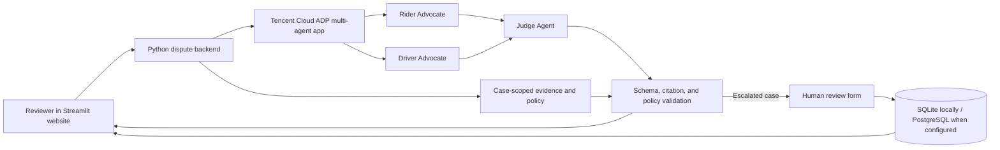

# RydeResolve

**Tencent Cloud AI CAN DO IT Hackathon Singapore 2026 — Digital Native Track (Ryde)**

**Challenge:** Multi-Agent Autonomous Dispute Resolution System

**Short blurb:** Fairer ride disputes through evidence-led AI review.

RydeResolve is a working prototype for reviewing rider–driver disputes. A Rider Advocate and Driver Advocate consider each side of a case, then a Judge Agent recommends an outcome using trip records and a versioned policy. The website presents the evidence, recommendation, and reasoning. When a case needs escalation, a human reviewer can write a decision **on behalf of the platform** and draft explanations for both the rider and driver.

The prototype uses sample data and recommends actions only. It does not issue refunds, send messages, or connect to a live Ryde account.

## Why this matters

Dispute handling requires support staff to compare complaints with GPS points, timestamps, chat logs, fare records, and policy. RydeResolve brings those inputs into one review flow. Its goal is to make standard cases faster to assess and make uncertain cases easier for a person to resolve with a clear record of what the AI recommended.

## What the prototype does

- **Three-agent review:** a published Tencent Cloud ADP multi-agent application coordinates the Rider Advocate, Driver Advocate, and impartial Judge. The Judge returns a structured recommendation with a ruling, refund amount, confidence estimate, policy and evidence references, and proposed messages to each party.
- **Evidence-led checks:** the Python backend gathers case-scoped trip, message, payment, history, metric, and policy records. It calculates route and waiting-time metrics, validates the Judge's output and citations, and escalates a recommendation that conflicts with the policy check or falls below the review threshold.
- **Visible investigation:** the Streamlit website shows the recommendation, cited records, a timestamped evidence timeline, policy details, and available ADP activity metadata. Individual advocate reports are not returned as separate structured outputs by the current integration.
- **Human-written platform review:** for a case marked `human_review`, a person can choose **Refund**, **No action**, or **Further review required**; enter a reviewer name or demo ID; write the final explanation; and draft separate rider and driver messages. A refund amount is required for a refund decision and cannot exceed the recorded charge. The saved review is shown alongside the original AI result, can be downloaded as JSON, and can be reopened through its review link. If further review is selected, a later decision is stored as a linked record.
- **Two case families and more:** the visible queue covers no-show and route-deviation cases, plus organiser-provided fare-dispute examples. The backend also loads the organiser's no-show-charge fixture.

### Human review in the website

This is the additional human-in-the-loop feature. If the Judge asks for human review, or the backend escalates because of low confidence or a policy mismatch, the website displays a **Review case** button. The reviewer sees the complaint, AI recommendation, escalation reason, policy version, and charge before writing the platform's decision and explanations. Saving the form creates a separate, timestamped record; it does not overwrite the AI output. The interface shows the human decision as the current resolution recommendation while retaining the original AI review for comparison.

The entered reviewer name is a demo label, not verified staff authentication. Rider and driver messages are drafts; saving a review does not send them. A recorded refund is a decision in the prototype, not a payment transaction.

## Architecture



The ADP agent configuration and handoffs live in the published Tencent Cloud application. This repository contains the website, evidence API, case data, prompt contracts, validation logic, and human-review storage. The optional FastAPI service exposes read-only `/tools/get_*` endpoints for an ADP application configured to call them.

## Demo walkthrough

1. Select a case in the **Case Queue** and, if useful, edit the rider's complaint.
2. Click **Investigate dispute**. The website sends the case to the published ADP multi-agent application.
3. Review the Judge's recommendation and open **Agent review** and **Evidence & policy** to inspect the reasoning, available activity events, records, and policy.
4. To demonstrate human review, select **NS04 — Pickup GPS is missing** or an escalated organiser case. After the investigation returns `human_review`, click **Review case**.
5. Enter a reviewer name, select a decision, write the final explanation and proposed messages to both parties, then click **Save human review**. Open **Original AI review** or download the JSON record to compare the human and AI decisions.

The demo queue includes `NS01`–`NS04`, `RT01`–`RT02`, `DISP-001`, and `DISP-003`. `NS` cases concern no-show fees; `RT` and `DISP-001` concern route deviation; `DISP-003` concerns a fare dispute. The other fixtures support backend verification but are not in the website dropdown.

## Run locally

Requires Python 3.11+ and a **published Tencent Cloud ADP multi-agent application** with an AppKey. Configure its Rider Advocate, Driver Advocate, and Judge agents and their evidence tools in ADP; the website cannot create that hosted configuration automatically.

```bash
python3 -m venv .venv
source .venv/bin/activate
python -m pip install -r requirements.txt
cp .env.example .env
```

On Windows, activate the environment with `.venv\Scripts\activate` and copy `.env.example` to `.env` manually or with `copy .env.example .env`.

Put your published application's key in `.env`:

```dotenv
ADP_APP_KEY=your_app_key_here
ADP_ENDPOINT=https://wss.lke.tencentcloud.com/adp/v2/chat
ADP_TIMEOUT_SECONDS=45
```

Start the website:

```bash
python -m streamlit run app.py
```

Streamlit normally opens at `http://localhost:8501`. The visible website uses live ADP mode and needs a working published application. The local policy check below does not call ADP.

To expose the optional read-only evidence API for agent tool configuration, run this in another terminal:

```bash
python -m uvicorn api:app --reload --port 8000
```

The API provides `/health` and POST endpoints `/tools/get_trip`, `/tools/get_messages`, `/tools/get_payment`, `/tools/get_metrics`, `/tools/get_policy`, and `/tools/get_history`. Each tool request uses a JSON body such as `{"case_id": "NS04"}`. A hosted ADP application needs a reachable API URL and corresponding tool setup; `localhost` is only reachable on your own machine.

### Review storage

Locally, human reviews are saved to `runtime/human_reviews.sqlite3`. For a deployed Streamlit service, set `DATABASE_URL` to a PostgreSQL connection string so reviews persist across restarts. On Render, the app requires `DATABASE_URL` for human-review storage. Keep `.env` and database credentials private.

## Verification

Run the deterministic local policy check without ADP credentials or token use:

```bash
python verify_cases.py
```

Run the unit and workflow tests after installing the requirements:

```bash
python -m unittest discover -s tests
```

To check selected cases against your published ADP app, explicitly request a live run (this consumes ADP allowance):

```bash
python verify_cases.py --live --cases NS04 DISP-001
```

The committed `validation/local_verification.json` is a **local policy baseline**, not a measured AI accuracy result. Model confidence is an uncalibrated estimate. Live behavior depends on the published ADP agent configuration, tools, and available quota.

## Repository map

| Path | Purpose |
| --- | --- |
| `app.py` | Streamlit website and human review workflow |
| `disputes/core.py` | Evidence gathering, metrics, policy checks, and result validation |
| `disputes/adp.py`, `disputes/prompts.py` | ADP client and agent output instructions |
| `api.py` | Read-only evidence API for agent tools |
| `human_review_store.py` | Saved human decisions and original AI snapshots |
| `data/`, `organiser_data/` | Synthetic cases, organiser fixtures, and versioned demo policies |
| `verify_cases.py`, `tests/` | Local checks and automated tests |

## Hackathon submission notes

The Digital Native challenge asks for a working multi-agent prototype, at least two dispute categories, visible inter-agent activity, an architecture diagram, a demo walkthrough, and source code. This README covers the architecture and walkthrough; the website exposes available ADP activity events. The handbook separately requires proof that CodeBuddy or WorkBuddy was used during development, including at least three screenshots or a screen recording of conversation history. Add genuine evidence from your development process to the submission; this repository does not include it.

All included case data is synthetic or an organiser-provided hackathon fixture. The policy files are demonstration references, not verified live Ryde policy. The prototype has no staff sign-in, payment execution, or message delivery, so operational use would require those integrations and review controls.
